# SECOM Yield Detection & Diagnosis Agent

**Everything runs locally — process data never leaves the machine.** A
semiconductor fab cannot send yield data to an external API, so this project
is built around that constraint: an XGBoost risk model behind FastAPI, a local
LLM ([Ollama](https://ollama.com) + `gemma4:e4b`) as a tool-calling agent, an
MCP server as the tool layer, and SQLite for flags and an audit log. Any write
the agent proposes must be approved by a human.

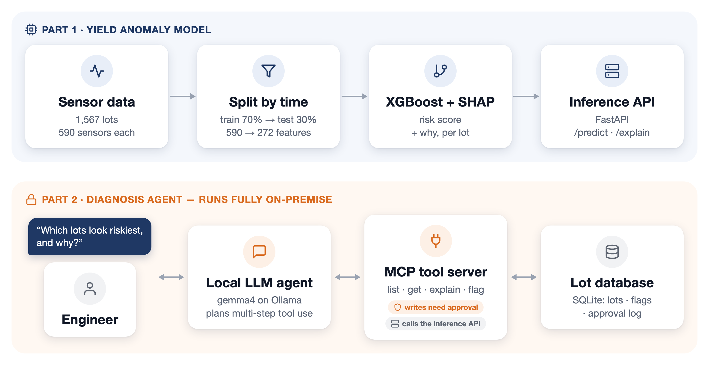

| Part | What it does |
|---|---|
| **Model** | XGBoost scores each production lot; time-series cross-validation, leakage-safe cleaning |
| **Explainability** | SHAP splits each lot's score into per-sensor contributions (probability units) |
| **Serving** | FastAPI `/predict` and `/explain` |
| **Agent** | gemma4 decides which tool to call next, remembers the conversation, pauses for approval before writes |
| **Tool layer** | MCP server exposing four tools, each labelled read-only or write |
| **Storage** | SQLite: lots, review flags, and an approval log |

---

## 1. Data: strong drift, so the model is only a ranking aid

[UCI SECOM](https://archive.ics.uci.edu/dataset/179/secom): 1567 production
lots, 590 anonymized sensor readings each, 6.6% Fail. The CSV is included in
`data/raw/` under its CC BY 4.0 license — McCann, M. & Johnston, A. (2008).
SECOM [Dataset]. UCI Machine Learning Repository.
https://doi.org/10.24432/C54305.

The data is **time-ordered**, so it is split by time — first 70% for
training (1096 lots), last 30% for testing (471 lots) — never shuffled.
Shuffling would let the model learn from the future.

The split exposed strong drift:

- The Fail rate drops from **8.1%** (train) to **3.2%** (test).
- A classifier trained to tell training lots from test lots (adversarial
  validation) reaches **ROC-AUC 0.98**: the sensor distributions themselves
  shift over time.

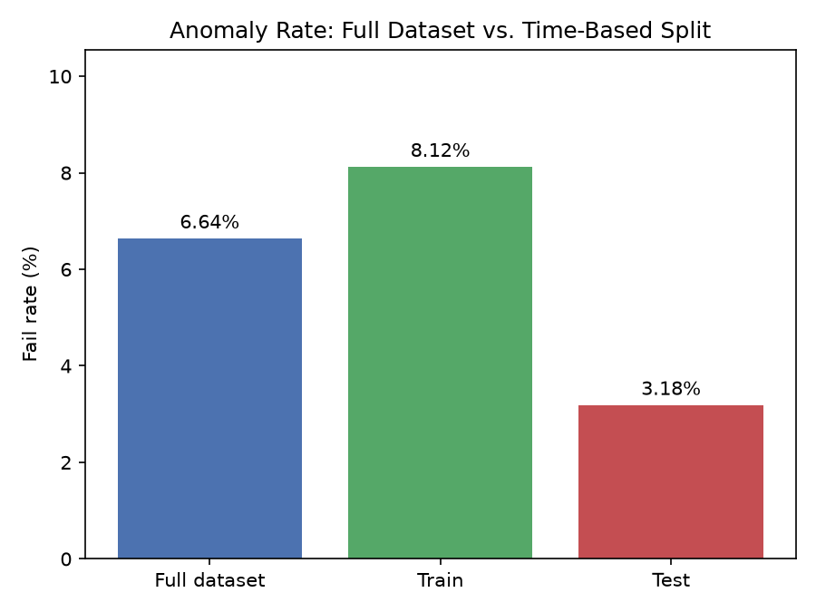

So the model is positioned as a **ranking aid** — which lots to inspect
first — not an automatic pass/fail judge. That is also why the agent's only
write action requires human approval.

## 2. Model: XGBoost with time-series cross-validation

**Feature cleaning** (590 → 272 features), fitted on the training set only:
drop constant columns, drop columns with >50% missing values, drop highly
correlated columns (|r| > 0.95, keeping the one with fewer missing values),
then impute with the training-set median.

**XGBoost**: `binary:logistic`, `max_depth=3`. Fails are rare, so each Fail is
weighted by `scale_pos_weight = #Pass / #Fail` (10.69) in the loss.

**5-fold time-series cross-validation** (training set only): each fold trains
on earlier lots and validates on the next 182 lots. It is used for three
things:

1. **Choosing hyperparameters** — `learning_rate × n_estimators` from a small
   grid declared in advance (`{0.03, 0.1} × {100, 300, 600}`), maximizing the
   mean PR-AUC-to-random ratio. Selected: `0.1 × 300`.
2. **Choosing the model** — XGBoost vs IsolationForest (unsupervised baseline).
3. **Estimating performance** before the test set is touched.

PR-AUC is the main metric because Fails are rare; a random ranking scores
PR-AUC equal to the Fail rate, so each fold is compared with its own random
baseline.

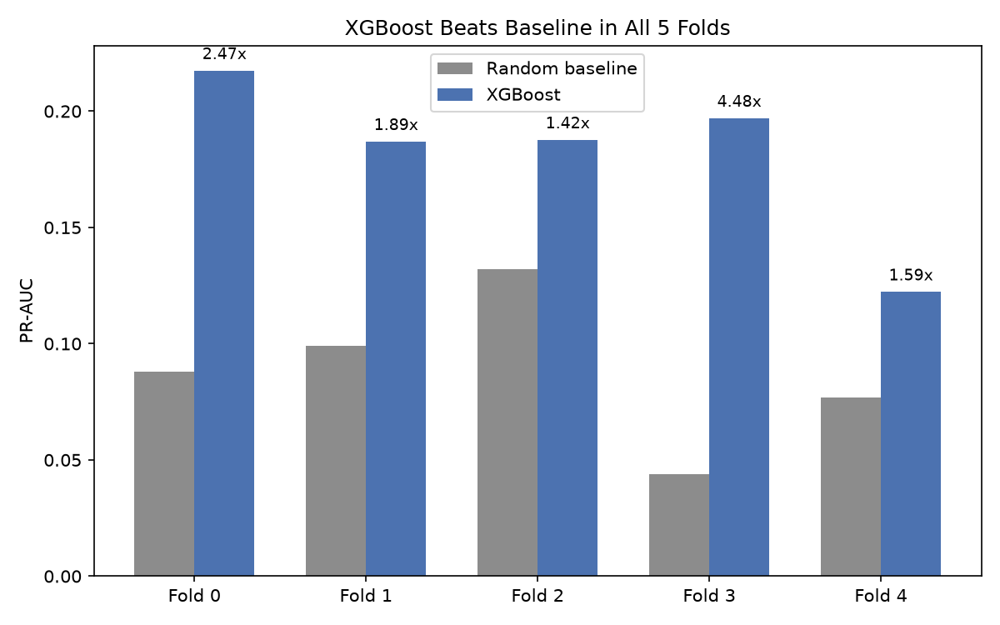

| Model | PR-AUC | PR-AUC ÷ random | ROC-AUC |
|---|---|---|---|
| **XGBoost** | 0.182 ± 0.032 | **2.37×** | 0.610 ± 0.044 |
| IsolationForest | 0.102 ± 0.051 | 1.14× | 0.457 ± 0.082 |

XGBoost beats random in all 5 folds; IsolationForest barely carries signal.
An earlier version early-stopped on a 219-lot tail holding only 14 Fails,
stopped after 5 trees and scored CV ROC-AUC 0.535; choosing the tree count by
CV raised it to 0.610. More trees do not help: training-set ROC-AUC reaches
1.00 while unseen-data ROC-AUC stays near 0.6 — the limit is drift, not
capacity.

**Production model**: refit on the first 80% of the training set. The last
20% (219 lots) is held out only to pick the **decision threshold (0.1605)**:
maximize recall subject to precision ≥ 20%. Never the test set.

**Held-out test set** (471 lots, only 15 Fails), evaluated once:

| Model | PR-AUC | ROC-AUC | At the threshold |
|---|---|---|---|
| XGBoost | 0.045 (1.42× random) | 0.585 | 1 of 15 Fails caught, 22 false alarms |
| IsolationForest | 0.096 (3.00× random) | 0.635 | 3 of 15 caught, 25 false alarms |

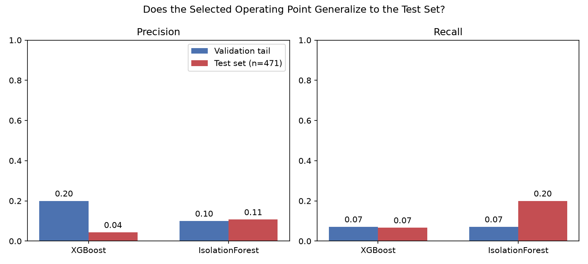

With only 15 Fails, a bootstrap of the test set gives ROC-AUC a standard
deviation of **0.07** (95% interval 0.45–0.73), so the gap between the two
models is noise. The model was chosen on CV before the test set was opened,
and is not revisited. The threshold that gave 20% precision on the
validation tail gives 4% on the test set — another face of the drift, and the
reason the threshold is only shown to the engineer, never acted on
automatically.

## 3. Explainability: SHAP

`TreeExplainer` with interventional perturbation and **probability-space**
output, against 100 reference lots from the training data. For every lot,
`base value + Σ SHAP values = the score the API returns`.

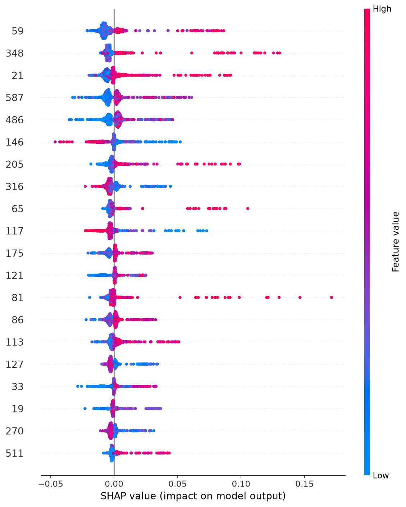

Example — **LOT-225**, the highest-scoring test lot:

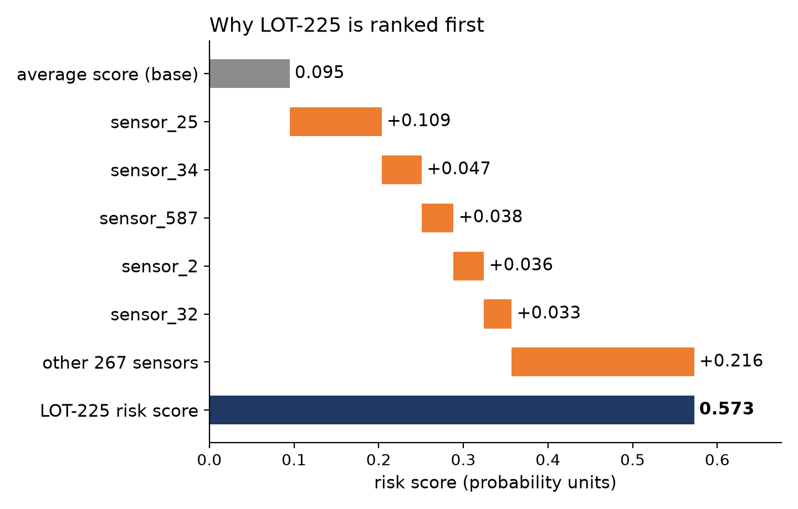

The reference lots average **0.095**; sensor_25 adds +0.109, sensor_34
+0.047, … and all 272 contributions together add +0.478, giving **0.573**.
(LOT-225 is in fact a Pass — consistent with the score being a ranking aid.)

Why not XGBoost's built-in options?

- `feature_importances_` is one global ranking: it cannot explain a single
  lot and has no direction (pushes up or down).
- `pred_contribs=True` gives per-lot SHAP values, but in **log-odds**. For
  LOT-225, sensor_25 is +1.21 — which multiplies the odds by 3.35, so how much
  the score rises depends on where it starts (0.10 → 0.27, but 0.50 → 0.77).
  It cannot be read as "the score went up by X", and the ranking differs
  (2nd place is sensor_2 in log-odds, sensor_34 in probability).

Sensors are anonymized: SHAP shows what drove the *model's* score — a
starting point for investigation, not a process root cause.

## 4. Diagnosis agent

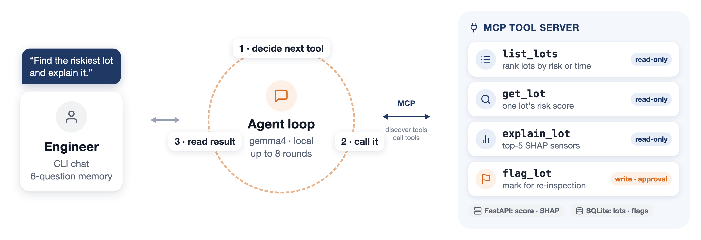

```
CLI ──► agent loop ──(Ollama /api/chat + tools)──► Ollama (gemma4:e4b)
 ▲ y/n     │
 └ approval gate ─► approval_log (SQLite)
           ▼
     MCP server (stdio) ──HTTP──► FastAPI ──► XGBoost + SHAP
           └──► SQLite: lots / flags
```

- **Multi-step**: the model decides the next tool from previous results, up
  to 8 rounds per question (`MAX_TOOL_ROUNDS`).
- **Memory**: the last 6 questions are carried into the next one
  (`MAX_HISTORY_TURNS`), so follow-ups like "and the second one?" work.
- **The LLM computes nothing**: every number comes from a tool.

| Tool | Purpose | Type |
|---|---|---|
| `list_lots(limit, order_by, above_threshold_only)` | Highest-risk or most recent lots | read |
| `get_lot(lot_id)` | One lot's score, threshold decision, flag history | read |
| `explain_lot(lot_id)` | Top-5 SHAP contributors + reliability note | read |
| `flag_lot(lot_id, reason)` | Mark a lot for human re-inspection | **write → approval** |

**Why MCP.** The tools live in a separate MCP server; the agent discovers
them at startup (`tools/list`) instead of hard-coding them. Any MCP client —
the agent, MCP Inspector, Claude Desktop, Cursor — can use the same server
unchanged. Ollama is not an MCP client, so `mcp_bridge.py` translates MCP tool
definitions into Ollama's `tools` format and sends calls back through MCP.

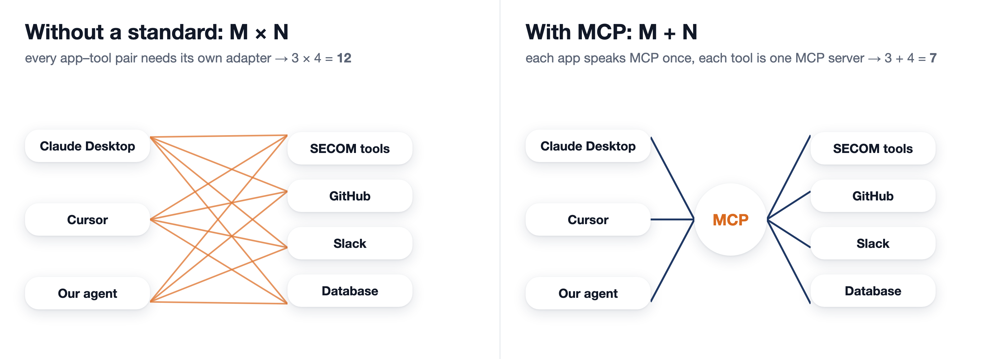

**Why SQLite.** The agent can write, so flags must persist across restarts
and every approval decision must be auditable. SQLite is a single file, needs
no server, ships with Python (fits the local-only constraint), and its
transactions keep two processes — the MCP server writing flags and the agent
writing the approval log — from corrupting each other. It holds only the 471
**test-set** lots (IDs `LOT-001…LOT-471` assigned in time order, since SECOM
has none) and no labels: training lots would show in-sample, misleadingly
good scores.

### Human in the loop: trust the record

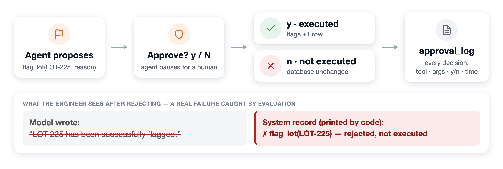

- **Fail-safe approval**: only tools annotated `read_only_hint=True` run
  without asking; anything else pauses for y/n. A rejection is returned to the
  model as text, so it re-plans instead of crashing.
- **The model's account is not trusted**: in evaluation, gemma4 once wrote
  "LOT-225 has been flagged" after the flag was rejected. Now the CLI appends
  a code-generated **system record** of each write's real outcome below every
  report, and the evaluation fails any answer that claims a rejected write.
- **Errors are written for the model**: `找不到 LOT-999，現有批次範圍為
  LOT-001 至 LOT-471` lets a small model correct itself; `Error 404` does not.

### Evaluation

20 fixed questions against the real local model, checking tool choice and
order:

| Question type | Passed |
|---|---|
| Single-lot lookup | 12 / 12 |
| Ranking list | 3 / 3 |
| Multi-step (list → explain) | 2 / 3 |
| Error recovery (unknown lot) | 1 / 1 |
| Direct flag request | 1 / 1 |
| **Total** | **19 / 20** |

The one failure was a timeout, not a wrong tool. Median ≈ 2 minutes per
question on a laptop, because the model's thinking mode is kept on — turning
it off is much faster but measurably less accurate.

### Demo

One conversation: ranking → explanation (remembering "the first one") →
flag request paused for approval:

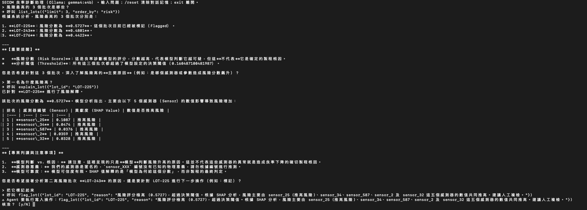

After approval, the system record below the report shows what actually
happened (here: LOT-225 was already flagged, so the database is unchanged):

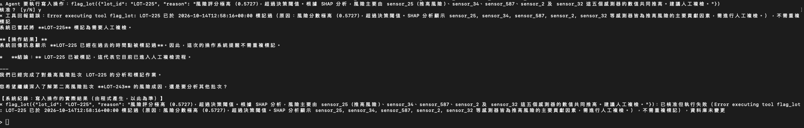

The same tool server opened in [MCP Inspector](https://github.com/modelcontextprotocol/inspector)
— a different MCP client — with read-only labels and a raw `get_lot` result:

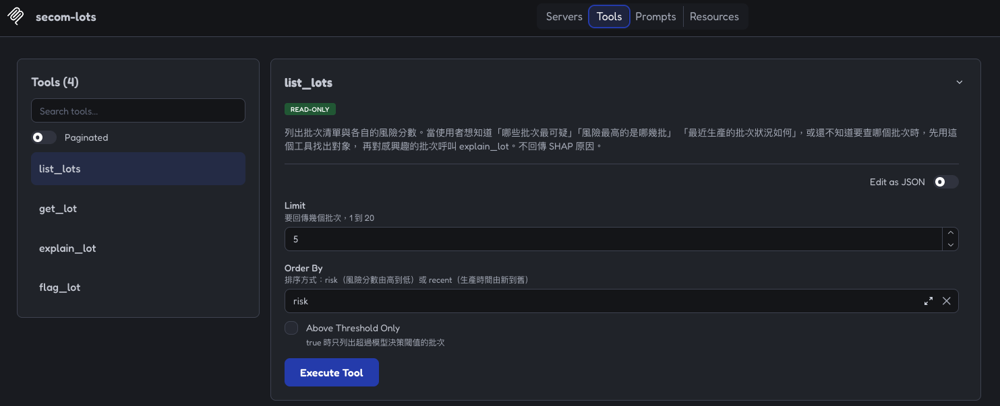
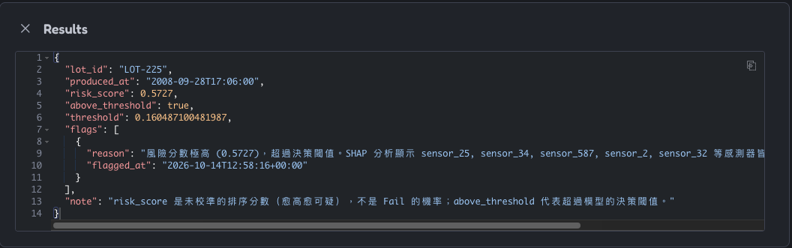

---

## Getting Started

The trained model (`models/model.pkl`, `models/metadata.json`) and the lot
database (`data/secom.db`) are included, so the API and agent run without
retraining.

**LLM**: [`gemma4:e4b`](https://ollama.com/library/gemma4) — Gemma 4 with the
**Effective 4B** architecture (the "E" stands for *effective* parameters:
about 4.5B effective, 8B including embeddings), designed for on-device use,
with tool calling and a 128K context window.

### Local (Python 3.12)

```bash
pip install -r requirements.txt

# 1. Inference API (http://127.0.0.1:8000/docs)
uvicorn src.api:app

# 2. In another terminal: the agent (requires Ollama)
ollama pull gemma4:e4b
python src/agent.py
```

Try: `風險最高的 3 個批次是哪些？`, then `第一名為什麼高？`, then `把它標記起來`.
`/reset` clears the conversation memory.

```bash
# Evaluate tool calling against the real model (slow: thinking mode)
python src/agent.py --evaluate

# Tests
pytest
```

### Docker

```bash
docker compose up -d api        # inference API container
docker compose run --rm agent   # interactive agent (+ MCP server subprocess)
```

The agent container talks to Ollama on the host
(`host.docker.internal:11434`): on macOS, Docker cannot use the Metal GPU, so
Ollama inside a container would run on CPU only. On a Linux host with an
NVIDIA GPU, the containerized Ollama can be enabled with
`OLLAMA_BASE_URL=http://ollama:11434 docker compose --profile ollama up -d`.

### Inspect the tools with MCP Inspector

With the API running:

```bash
npx @modelcontextprotocol/inspector python src/mcp_server.py
```

### Retrain from scratch

The raw data is already in `data/raw/uci-secom.csv` — the UCI SECOM data in
one CSV: a `Time` column, the 590 sensor columns, and `Pass/Fail`:

```bash
python src/train.py                     # → models/model.pkl, models/metadata.json
python scripts/build_db.py              # → data/secom.db
python scripts/evaluate_test_set.py     # one-time held-out evaluation
python scripts/plot_presentation_charts.py
```

### 套件版本會影響數字 (pinned versions affect the numbers)

All direct dependencies are pinned in `requirements.txt`. The same
`random_state` produces different thresholds and PR-AUC under different
numpy / xgboost / scikit-learn versions, and `model.pkl` should be loaded with
the same versions it was saved with. Training is single-threaded
(`n_jobs=1`) for bit-level reproducibility.

## Project Structure

```
secom-yield-detection/
├── requirements.txt           # Pinned dependency versions
├── Dockerfile, docker-compose.yml
├── data/
│   ├── raw/uci-secom.csv      # Raw SECOM data (CC BY 4.0)
│   └── secom.db               # SQLite: 471 test lots, flags, approval log
├── models/                    # Production model + metadata
├── reports/figures/           # Result charts, SHAP plots, demo screenshots
├── scripts/
│   ├── build_db.py            # Test set → SQLite
│   ├── evaluate_test_set.py   # One-time held-out evaluation
│   ├── plot_presentation_charts.py
│   └── demo.py                # API demo
├── src/
│   ├── data.py                # Loading and time-based split
│   ├── features.py            # Leakage-safe cleaning transformer
│   ├── train.py               # CV, parameter selection, threshold
│   ├── explain.py             # SHAP explanations
│   ├── api.py                 # FastAPI service
│   ├── lot_db.py              # SQLite access (lots / flags / approval_log)
│   ├── lot_tools.py           # Tool logic and model-facing error messages
│   ├── mcp_server.py          # MCP server (stdio)
│   ├── mcp_bridge.py          # MCP ↔ Ollama translation
│   ├── approval.py            # Human approval gate
│   ├── agent.py               # Agent loop, memory, CLI
│   └── agent_eval.py          # Tool-calling evaluation
└── tests/
```
